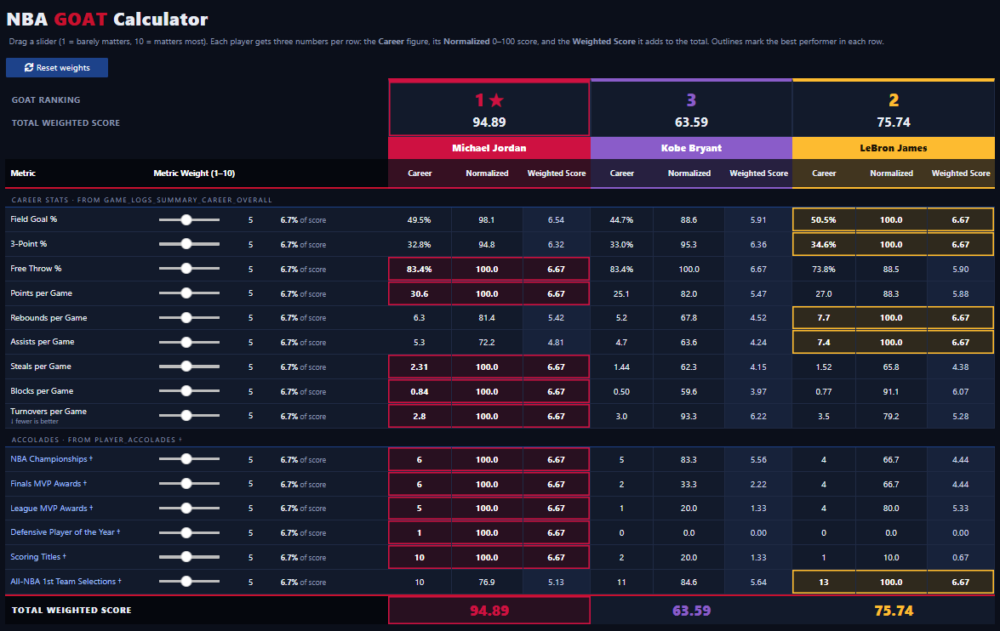
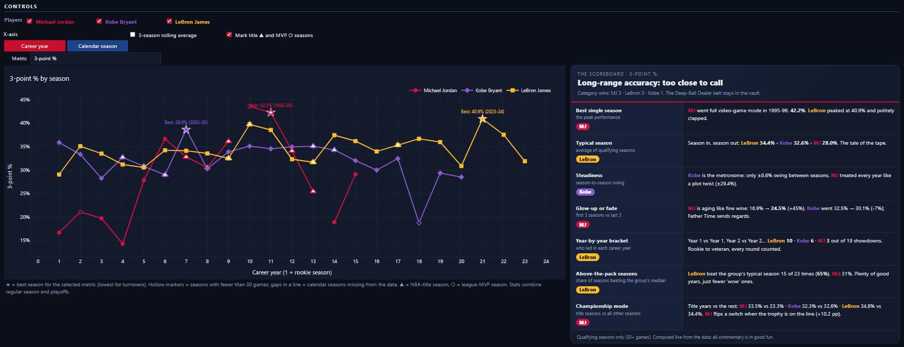
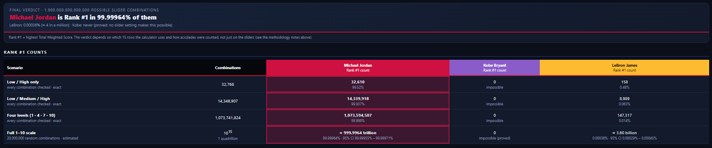

# NBA GOAT Analysis & Interactive Dashboard

## Problem Statement

The debate over who is the NBA's GOAT (Greatest Of All Time) is often subjective and tends to focus on only a few selective statistics.

## Objective

This project creates a comprehensive analysis and interactive dashboard to compare career statistics and help determine the NBA GOAT.

Using data extracted from official sources, the dashboard allows users to analyze and compare granular career stats between **Michael Jordan**, **Kobe Bryant**, and **LeBron James**.

The dashboard includes key metrics across regular season and playoff careers, including:
`FGM`, `FGA`, `FG_PCT`, `FG3M`, `FG3A`, `FG3_PCT`, `FTM`, `FTA`, `FT_PCT`, `OREB`, `DREB`, `REB`, `AST`, `STL`, `BLK`, `TOV`, `PF`, and `PTS`.

---

## Data Sources

### Primary Source: NBA API

* **Endpoint:** `nba_api.stats.endpoints.playergamelog`
* **URL:** [https://github.com/swar/nba_api](https://github.com/swar/nba_api)
* **Format:** JSON / Python API endpoint (pandas DataFrame response)
* **Coverage:** Individual game-by-game statistics for Michael Jordan, Kobe Bryant, and LeBron James across their entire regular season and playoff careers.
* **Why it fits:** Provides official, granular game log data directly from NBA Stats, enabling precise statistical calculations.
* **Known limitations:** Rate limits and occasional connection timeouts requiring request delays and error handling.

### Fallback Source: Kaggle NBA Dataset

* **Dataset:** Michael Jordan, Kobe Bryant, and LeBron James Stats
* **URL:** [https://www.kaggle.com/datasets/xvivancos/michael-jordan-kobe-bryant-and-lebron-james-stats](https://www.kaggle.com/datasets/xvivancos/michael-jordan-kobe-bryant-and-lebron-james-stats)
* **Format:** CSV
* **Coverage:** Historical career game logs for all three players.
* **Why it fits:** Serves as a reliable offline backup if the live `nba_api` endpoint experiences downtime or rate limits.
* **Known limitations:** Static dataset that is not automatically updated with live games.

---

## Dashboard Features

1. **GOAT Calculator:** Allows users to assign weights (from 1 to 10) to each statistical KPI using interactive sliders. The calculator dynamically recalculates each player's custom overall score based on the user's weighting preference.
2. **Stats Dashboard:** Enables users to select specific statistics and compare player trends side-by-side across their respective career seasons (using career season number on the X-axis).

---

## Getting Started & Execution

Follow these steps to set up your environment, install the required packages, and run the data ingestion pipeline.

### Prerequisites

* Python 3.8 or higher installed on your system.
* Git installed on your system.

### Step 1: Clone and Navigate to the Repository

Open your terminal (Command Prompt, PowerShell, or Terminal) and clone the repository, then navigate into your local project directory:

```bash
git clone https://github.com/ambs78/dep-data-engineering-open-track-ambs.git
cd dep-data-engineering-open-track-ambs
```

### Step 2: Create and Activate a Virtual Environment

Isolate your Python dependencies by creating a virtual environment named `.venv`:

```bash
python -m venv .venv
```

Activate the environment based on your operating system:

**Windows (Command Prompt):**
```bat
.venv\Scripts\activate.bat
```

**macOS / Linux:**
```bash
source .venv/bin/activate
```

### Step 3: Install Required Modules

Install all required Python packages from the `requirements.txt` file into your virtual environment:

```bash
pip install -r requirements.txt
```

### Step 4: Export Python Dependencies (Optional Maintenance)

If you install new packages while developing, you can freeze and update the `requirements.txt` file by running:

```bash
pip freeze > requirements.txt
```

### Step 5: Run Data Ingestion

Execute the `ingest.py` script located in the `scripts/` folder to fetch and process player statistics:

```bash
python scripts/ingest.py
```

### Step 6: Transform the Data

Execute the `transform.py` script located in the `scripts/` folder to fetch and process player statistics.
This will combine the data from the 3 players, ang get their career averages for `FGM`, `FGA`, `FG_PCT`, `FG3M`, `FG3A`, `FG3_PCT`, `FTM`, `FTA`, `FT_PCT`, `OREB`, `DREB`, `REB`, `AST`, `STL`, `BLK`, `TOV`, `PF`, and `PTS`.

This will be the data that will be used in creating the Main GOAT Dashboard and Calculator.

```bash
python scripts/transform.py
```

### Step 7: Launch the Interactive GOAT Dashboard

Open the dashboard notebook, `notebooks/nba_goat_dashboard.ipynb`. It reads the processed files created in Step 6 together with the accolades table described below. Make sure the virtual environment from Step 2 is activated, then start JupyterLab from the repository root:

```bash
jupyter lab notebooks/nba_goat_dashboard.ipynb
```

JupyterLab opens in your default web browser (usually at `http://localhost:8888/lab`). If it does not open automatically, copy the URL printed in the terminal (it ends with `?token=...`) into your browser, and keep the terminal window open while you work. Once the notebook is open, choose **Run > Run All Cells** from the menu bar at the top. The dashboard appears in the cell outputs, and the charts, sliders, and scoreboard update live as you interact with them.

* The notebook looks for the game-log CSVs in `../data/processed` and the accolades CSV in `../data/external`, so it works whether you open it from the `notebooks/` folder or from the repository root.
* The packages it needs (`plotly`, `ipywidgets`, `jupyterlab`) are included in `requirements.txt` from Step 3.
* The Final Verdict section runs a large simulation when you choose **Run All Cells**, so the full run takes roughly 20 to 40 seconds on a typical laptop.
* The pinned `pandas==3.0.3` and `numpy==2.5.1` require a recent Python version. The notebook was tested with Python 3.12.
* GitHub cannot render ipywidgets or Plotly JavaScript, so the sliders and charts only work in JupyterLab, Jupyter Notebook 7, VS Code, or GitHub Codespaces.

---

## Interactive GOAT Dashboard (Jupyter Notebook)

The notebook turns the processed data into a dark-mode, NBA-themed dashboard comparing **Michael Jordan**, **Kobe Bryant**, and **LeBron James**. It has three sections: a GOAT Calculator, a Trend Explorer, and a Final Verdict.

| Section | Data source |
|---|---|
| GOAT Calculator | `data/processed/game_logs_summary_career_overall.csv` and `data/external/player_accolades.csv` |
| Trend Explorer | `data/processed/game_logs_summary_per_season.csv` (title and MVP markers use `data/external/player_accolades.csv`) |
| Final Verdict | the same normalized scores as the GOAT Calculator (`game_logs_summary_career_overall.csv` and `player_accolades.csv`) |

### Section 1: GOAT Calculator

Decide what "greatest" means to you by weighting 15 rows: 9 career stats and 6 accolades.

* **Career stats:** Field Goal %, 3-Point %, Free Throw %, Points per Game, Rebounds per Game, Assists per Game, Steals per Game, Blocks per Game, and Turnovers per Game (fewer is better).
* **Accolades:** NBA Championships, Finals MVP Awards, League MVP Awards, Defensive Player of the Year, Scoring Titles, and All-NBA 1st Team Selections.
* **Weight sliders (1 to 10):** each row has its own slider, and a readout shows that row's share of the total score. Everything recalculates live as you drag, and a **Reset weights** button returns every slider to 5.
* **Three numbers per player, per row:**
  * **Career:** the actual figure from the data.
  * **Normalized:** the career figure scored 0 to 100 against the best of the three players.
  * **Weighted Score:** the normalized score multiplied by the row's share of the total weight.
* **GOAT ranking and total:** a scorecard above each player's three columns shows their rank and Total Weighted Score (the sum of their weighted scores), and the table repeats the totals at the bottom.
* **Best-in-row highlight:** the best performer in each row has their Career, Normalized, and Weighted Score cells outlined in their player color (for turnovers, the lowest value wins).
* **Built-in explanation:** a "How the weighted scores are normalized and calculated" panel under the table includes a worked example that updates with your sliders.
* **No bonus for a longer career:** total points, total games, and seasons played are intentionally not used.

**How the scoring works**

1. Normalized score = `career value / best value x 100` (for turnovers: `best value / career value`), so the leader in every row scores 100.
2. Share of the weight = `your slider value / sum of all 15 slider values`.
3. Weighted score = `normalized score x share`.
4. Total Weighted Score = the sum of a player's weighted scores. The highest total is GOAT #1.

**Player headshots (optional, off by default)**

The scorecards at the top of the calculator show each player's GOAT rank and Total Weighted Score, aligned above that player's three columns. To add a picture above them, set `SHOW_HEADSHOTS = True` in the notebook's config cell, save images you have the right to use in `notebooks/assets/headshots/` using these file names (`.png`, `.jpg`, `.jpeg`, or `.webp`), then re-run the notebook:

* `michael_jordan.jpg`
* `kobe_bryant.jpg`
* `lebron_james.jpg`

A player without an image shows their initials. Images are shown without a frame, so use pictures with a transparent background or a background that matches the calculator's card color (`#121A2B`) for a seamless look. Set `HEADSHOT_STYLE = "circle"` for round, ringed photos instead.

**Customizing the calculator**

To add, remove, or swap rows (for example, use All-Star selections instead of Scoring Titles), edit the `CALC_ROWS` list in the GOAT Calculator cell of the notebook.

<p align="center">
  
</p>
<p align="center"><em>GOAT Calculator: drag the sliders and the rankings update live.</em></p>

### Section 2: Trend Explorer

Compare how each career evolved, season by season, for any metric.

* **Metric dropdown:** 15 metrics, including points, True Shooting %, field goal %, 3-point %, free throw %, assists, rebounds, steals, blocks, turnovers, 3-point attempts, free-throw attempts, games played, and win %.
* **Controls:** choose which players to show, switch the X-axis between career year (rookies line up at year 1) and calendar season, add a 3-season rolling average, and toggle the title (triangle) and MVP (circle) season markers.
* **Chart conventions:** a star marks each player's best season for the chosen metric, hollow markers flag seasons with fewer than 30 games, and a broken line marks a calendar gap in the data (such as a retirement).
* **The Scoreboard (right side):** an insights table that compares the players against each other on the chosen metric, written with a bit of attitude. It covers best single season, typical season, steadiness, glow-up or fade, a year-by-year bracket (same career year versus same career year), above-the-pack seasons, and championship mode (title seasons versus all other seasons). The headline names the winner of the most categories and awards a playful "belt" such as *Bucket Boss* or *Safe Hands Champion*.
* **Live and data-driven:** the scoreboard recalculates whenever you change the metric or the selected players. It uses qualifying seasons only (30 or more games), and every number in it is computed from the data.

<p align="center">
  
</p>
<p align="center"><em>Trend Explorer: pick a metric to compare the careers, with the scoreboard alongside.</em></p>

### Section 3: Final Verdict

At the bottom of the notebook, the Final Verdict counts how many times each player is Rank #1 across every possible way of setting the 15 calculator sliders.

* **The size of the problem:** 15 sliders with 10 settings each is 10^15 (1,000,000,000,000,000) possible combinations, which is too many to check one by one. The verdict combines three methods.
* **Exact counts on coarse grids:** every combination in which each slider is set to one of a few levels is evaluated, with no sampling: Low / High (2^15 = 32,768 combinations), Low / Medium / High (3^15 = 14,348,907), and four levels of 1, 4, 7, and 10 (4^15 = 1,073,741,824).
* **Full 1 to 10 scale:** 20 million random combinations are scored, and the shares are scaled up to the 10^15 total with a 95% confidence interval.
* **Exact lock-out test:** a geometric check over all possible slider settings proves when a player cannot be Rank #1 under any setting.
* **What it shows:** a headline verdict and a table of Rank #1 counts for every scenario: exact counts for the three grids, plus the estimate for the full 1 to 10 scale.
* **Runs once:** it uses the same normalized scores as the calculator, so it does not change when you move a slider.
* **Depends on the rows you choose:** the verdict reflects which 15 rows the calculator uses and how the accolades were counted, so editing `CALC_ROWS` or the accolades table changes it.

<p align="center">
  
</p>
<p align="center"><em>Final Verdict: how many times each player is Rank #1 across every slider combination.</em></p>

### Accolades Data (External)

Championships, awards, and honors are not available in the game-log data, so they are stored in a separate, editable table:

* **File:** `data/external/player_accolades.csv`
* **Compiled:** 5 Nov 2026, from NBA.com, ESPN, and Wikipedia / Basketball-Reference-based career achievement lists.
* **Fallback:** the same values are embedded in the notebook, but the CSV takes priority if it exists. Edit the CSV to correct or extend any number, then re-run the notebook.
* **Validation:** the notebook checks the table when it loads (for example, that the listed title seasons match the title count and exist in the season data).

---

## Methodology & Limitations

* **Combined stats:** statistics combine regular season and playoffs. Per-season points are derived as `2*FGM + 3PM + FTM` and reconciled with the career `PTS_AVE` when the notebook loads.
* **Normalization:** each row is scaled 0 to 100 against the best of the three players, so results are relative, not absolute. This compresses near-ties (for example, free-throw %), so rows with small real gaps still look close.
* **Weighting:** sliders from 1 to 10 become shares of the total weight, so the shares always add up to 100%. With equal weights, the 6 accolade rows make up 40% of the score, so lowering their sliders shows how much the ranking depends on accolades.
* **Accolades are external:** counts come from the compiled table above, not from the game-log CSVs. Voting rules and eligibility have changed over time (for example, LeBron's 2026 All-NBA streak ended under the league's 65-game minimum), and counts such as Finals MVPs depend on teammates and opponents.
* **Final Verdict:** counts are exact where every combination is evaluated (coarse grids of up to about 1 billion combinations), estimated from 20 million random combinations on the full 1 to 10 scale (with 95% confidence intervals), and a geometric test proves when a player cannot be Rank #1 under any setting. The result depends on the 15 rows used, including that 6 of them are accolades.
* **Playful insights:** the Trend Explorer commentary is generated from the data using fixed templates. It is meant to be fun, not definitive.
* **Not included:** advanced metrics (PER, WS, BPM) and player ages are not in the data and were not added.
* **Small sample:** with only three players, every ranking is relative, and the GOAT score is a model of your own priorities rather than an objective truth.
